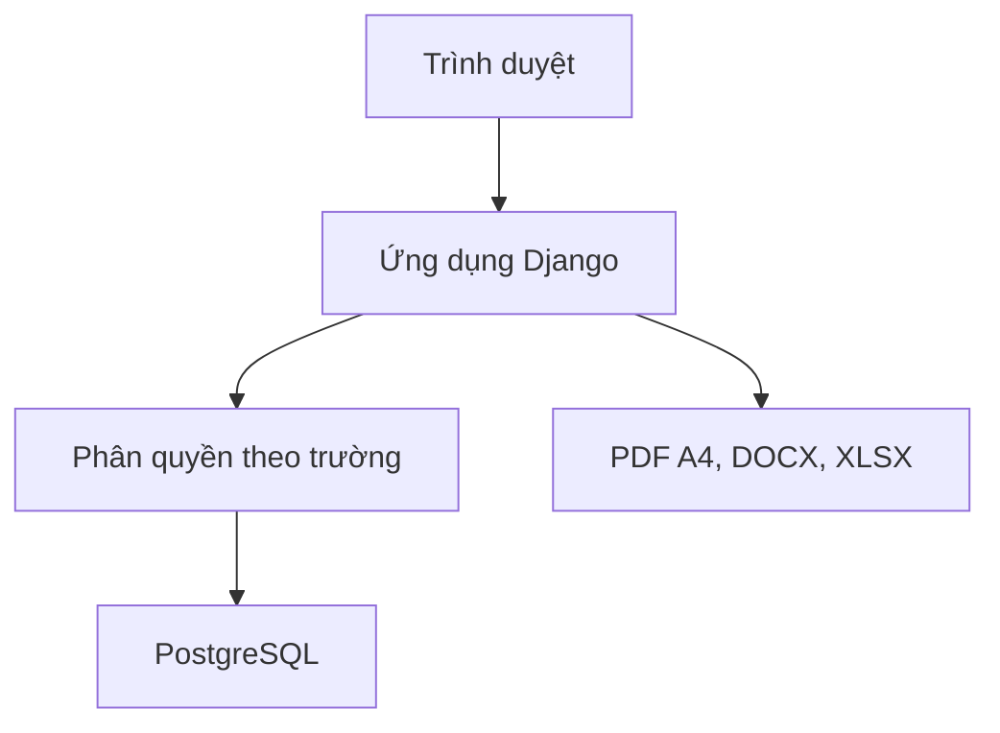

# EDUSCHOOL Manager

Ứng dụng web tiếng Việt cho nghiệp vụ giáo vụ tại Trường PTDT Nội trú Na Rì và các trường khác. Phiên bản đầu tập trung vào lịch trực, chấm công, phân quyền và báo cáo in A4. Dữ liệu được lưu trong cơ sở dữ liệu, với từng tài khoản gắn vào một trường.

## Trang giới thiệu GitHub Pages

Mở **Settings → Pages** trong kho GitHub. Chọn **Deploy from a branch**, chọn nhánh **main** và thư mục **/docs**, sau đó bấm **Save**. GitHub hiển thị địa chỉ trang ở mục **Visit site** khi xuất bản xong. Trang này giới thiệu phần mềm và dẫn tới hướng dẫn triển khai. Tính năng đăng nhập và dữ liệu dùng chung chạy trên máy chủ theo phần bên dưới.

## Xuất bản qua Render

[](https://render.com/deploy?repo=https%3A%2F%2Fgithub.com%2Fhuadim%2Fptdtnoitrunari)

1. Mở nút triển khai, chọn không gian làm việc trên Render và xem lại chi phí. Cấu hình tạo một dịch vụ web và một cơ sở dữ liệu PostgreSQL trả phí tại Singapore.
2. Điền `EDUSCHOOL_PRINCIPAL_PASSWORD` ngay trên trang Render. Dùng mật khẩu riêng, từ 12 ký tự trở lên, rồi xác nhận **Deploy Blueprint**.
3. Khi dịch vụ web hiện **Live**, mở địa chỉ `onrender.com` trên trang dịch vụ và đăng nhập bằng `hieutruong.nari`. Trường và tài khoản được tạo tự động.
4. Sau khi đăng nhập thành công, xóa biến `EDUSCHOOL_PRINCIPAL_PASSWORD` tại **Environment** của dịch vụ web. Những lần triển khai sau giữ nguyên tài khoản và mật khẩu đã đặt. Có thể cập nhật tên hiển thị của hiệu trưởng trong **Nhân sự**.

Cơ sở dữ liệu dùng kết nối nội bộ mã hóa. Hệ thống phục vụ qua HTTPS, cấu hình bí mật Django tự động và dùng PostgreSQL cho dữ liệu trường. Khi muốn đưa phiên bản mới từ GitHub lên, chọn **Manual Deploy → Deploy latest commit** trong dịch vụ Render.

## Chạy thử trên máy tính

Cần Python 3.12 và phông DejaVu Sans. Trên Debian hoặc Ubuntu, cài gói `fonts-dejavu-core`. Trên Windows, đặt hai tệp `DejaVuSans.ttf` và `DejaVuSans-Bold.ttf` vào một thư mục rồi đặt biến `PDF_FONT_DIR` trỏ tới thư mục đó.

PowerShell trên Windows

```powershell
git clone https://github.com/huadim/ptdtnoitrunari.git
cd ptdtnoitrunari
py -3.12 -m venv .venv
.\.venv\Scripts\python -m pip install -r requirements.txt
$env:DJANGO_DEBUG = "1"
.\.venv\Scripts\python manage.py migrate
.\.venv\Scripts\python manage.py seed_demo
.\.venv\Scripts\python manage.py runserver
```

Bash trên Linux hoặc macOS

```bash
git clone https://github.com/huadim/ptdtnoitrunari.git
cd ptdtnoitrunari
python3.12 -m venv .venv
source .venv/bin/activate
python -m pip install -r requirements.txt
export DJANGO_DEBUG=1
python manage.py migrate
python manage.py seed_demo
python manage.py runserver
```

Mở [http://127.0.0.1:8000](http://127.0.0.1:8000). Lệnh `seed_demo` in tên đăng nhập và mật khẩu ngẫu nhiên cho ba vai trò dùng thử. Chế độ thử nghiệm dùng SQLite và dữ liệu hư cấu. Khi muốn tạo trường thật, tạo cơ sở dữ liệu PostgreSQL riêng và dùng lệnh `create_school`.

## Luồng làm việc tại trường

1. **Hiệu trưởng** vào **Cấu hình nhà trường**, kiểm tra loại trực, số người/ngày, ngày lễ và tạo mức công theo từng nhóm ngày và ngày hiệu lực. Ca hoàn thành chỉ được ghi nhận sau khi có mức công phù hợp.
2. **Giáo vụ** nhập hồ sơ hoặc tải mẫu Excel ba cột trong **Nhân sự**. Hãy định dạng cột mã nhân sự dưới dạng văn bản để giữ số 0 đầu mã. Hiệu trưởng cấp tài khoản và gán vai trò tại danh sách này.
3. **Giáo vụ** tạo lịch trực theo tháng và loại trực, xếp thủ công hoặc tự động, khóa ngày cần giữ và trình duyệt. **Hiệu trưởng** hoặc **phó hiệu trưởng được ủy quyền** duyệt rồi công bố.
4. **Giáo viên** xem ca của mình, gửi đề nghị nghỉ hoặc trực thay. Người có quyền duyệt chọn nhân sự thay và hệ thống lưu cả người ban đầu lẫn người thực hiện. Đề nghị nghỉ trùng ca trực đã duyệt cần xử lý ca thay trước.
5. **Giáo vụ** xác nhận từng ca đã đến ngày thực hiện. Ca trực thay hoàn thành được tính cho người thay. Người phân công ban đầu vẫn có lượt phân công trong báo cáo. Chấm công lưu nhóm ngày, hệ số và công tại lần xác nhận. **Hiệu trưởng** duyệt và khóa theo tháng. Mở lại cần lý do và được ghi nhật ký.
6. Chọn phạm vi từ một đến 12 tháng trong **Chấm công và báo cáo** để tổng hợp tháng, quý, học kỳ hoặc năm học theo mốc của trường. Có bảng so sánh số ca và công theo tổ chuyên môn. Mở PDF A4 để xem trước rồi chọn **In** trong trình xem PDF. Có tệp Word và Excel để chỉnh sửa hoặc đối chiếu.
7. Trong **Thời khóa biểu**, giáo vụ lập tuần, thêm tiết và trình duyệt. Bộ lọc theo lớp, mã giáo viên hoặc phòng áp dụng cả khi xuất tệp.

## Phân quyền

| Thao tác | Hiệu trưởng | Phó hiệu trưởng | Giáo vụ | Tổ trưởng | Giáo viên |
|---|---|---|---|---|---|
| Tạo hồ sơ, nhập Excel, lập lịch và xác nhận chấm công | Có | | Có | | |
| Cấp tài khoản, phân quyền, cấu hình mức công, xem nhật ký | Có | | | | |
| Duyệt/công bố lịch và xử lý đề nghị | Có | Khi được ủy quyền duyệt lịch | | | |
| Duyệt, khóa, mở lại bảng chấm công | Có | Khi được ủy quyền khóa công | | | |
| Xem/xuất báo cáo chấm công | Toàn trường | Toàn trường khi được ủy quyền khóa công, phạm vi cá nhân mặc định | Toàn trường | Tổ chuyên môn | Cá nhân |
| Xem lịch công bố | Toàn trường | Theo phạm vi ủy quyền | Toàn trường | Tổ chuyên môn | Cá nhân |
| Gửi yêu cầu nghỉ/trực thay và xem thông báo | Cá nhân | Cá nhân | Cá nhân | Cá nhân | Cá nhân |

Quản trị viên hạ tầng tạo trường và tài khoản hiệu trưởng qua lệnh vận hành. Tài khoản hiệu trưởng chỉ quản trị dữ liệu trường của mình.

## Triển khai PostgreSQL và HTTPS

Kho mã nguồn chứa cấu hình cho máy chủ Linux có Docker Compose. Trỏ tên miền tới máy chủ và mở cổng 80, 443 cho Caddy. Sao chép `.env.example` thành `.env`, đặt tên miền và hai bí mật khác nhau. Có thể tạo từng bí mật bằng `python -c "import secrets; print(secrets.token_urlsafe(48))"`.

```bash
docker compose up -d --build
docker compose logs -f web
```

Khi web đã khởi động, tạo trường và nhập mật khẩu hiệu trưởng tại lời nhắc.

```bash
docker compose exec web python manage.py create_school \
  --slug na-ri --name "Trường PTDT Nội trú Na Rì" --location "Na Rì" \
  --username hieutruong.nari --principal "Họ tên hiệu trưởng"
```

Nếu triển khai ngoài Docker, có thể cấu hình `POSTGRES_HOST`, `POSTGRES_PORT`, `POSTGRES_DB`, `POSTGRES_USER`, `POSTGRES_PASSWORD`, `POSTGRES_SSLMODE`, `DJANGO_SECRET_KEY`, `DJANGO_ALLOWED_HOSTS` và `DJANGO_TRUSTED_ORIGINS`. Chỉ bật `DJANGO_TRUST_PROXY=1` khi ứng dụng được cô lập phía sau proxy do đơn vị vận hành kiểm soát. Caddy phục vụ tệp tĩnh được tạo bằng `collectstatic`.

Lệnh sao lưu cơ sở dữ liệu để đưa vào lịch vận hành

```bash
docker compose exec -T db pg_dump -U eduschool -Fc eduschool > eduschool-backup.dump
```

Tệp sao lưu chứa dữ liệu nhân sự. Bảo quản ở nơi được cấp quyền và kiểm tra khôi phục vào cơ sở dữ liệu riêng trước khi sử dụng cho trường. Hệ thống chưa có sao lưu định kỳ tích hợp.

## Thiết kế và nghiệm thu



- `eduschool/` cấu hình HTTP, phiên đăng nhập, cơ sở dữ liệu và các đường dẫn. `school/` chứa nghiệp vụ, biểu mẫu và giao diện. `school/migrations/` chứa lược đồ, khóa và trigger.
- Tài khoản xác định trường qua hồ sơ nhân sự. Truy vấn nghiệp vụ luôn lấy phạm vi trường từ phiên đăng nhập. PostgreSQL kiểm tra thêm các tham chiếu chéo trường ở lịch trực, đề nghị, chấm công và thời khóa biểu. Các thao tác ghi của cùng một trường được tuần tự hóa trong giao dịch.
- Bộ tìm lịch giới hạn thời gian xử lý bằng số nút tìm kiếm. Các điều kiện cứng gồm đủ người, nghỉ đã duyệt, khoảng cách tối thiểu, cặp cuối tuần, ngày khóa và không trùng ca theo ngày. Thuật toán ưu tiên cân bằng lượt và cuối tuần, giảm lặp cặp, hướng tới khoảng cách 7–8 ngày. Khi hết giới hạn tìm kiếm, ứng dụng giữ lịch cũ và nêu khu vực cần xem lại.
- Quy đổi công theo loại trực, ngày hiệu lực và nhóm ngày. Lịch nháp, lịch đã công bố và kết quả chấm công là các trạng thái tách biệt. Truy cập tệp xuất được kiểm tra bằng cùng phạm vi dữ liệu với màn hình.

```bash
DJANGO_DEBUG=1 python manage.py makemigrations --check --dry-run
DJANGO_DEBUG=1 python manage.py test
```

Kiểm thử bao gồm đăng nhập và CSRF, quyền truy cập, truy cập chéo trường, nhập Excel có lỗi và hợp lệ, xếp lịch có ngày nghỉ và ngày khóa, lịch bất khả thi, trực thay, mức công và khóa tháng, xuất tệp thực và trùng tiết. Ca kiểm thử trigger chỉ chạy khi có PostgreSQL.

## Phạm vi còn lại

| Hạng mục | Tình trạng |
|---|---|
| Lịch trực | Hỗ trợ xếp theo ngày, một người không nhận hai nhiệm vụ trực trong cùng ngày. Chưa có ca theo giờ/qua đêm, quy tắc nhân sự theo từng loại trực, xác nhận nhận ca thay hoặc bộ tối ưu tìm nghiệm toàn cục. |
| Thời khóa biểu | Lập thủ công theo tuần, kiểm tra trùng và xuất theo phạm vi lọc. Chưa có xếp tự động, kéo thả, lịch sử phiên bản đã công bố hoặc quản lý danh mục môn/lớp/phòng đầy đủ. |
| Báo cáo | Có bộ in lịch trực, thời khóa biểu và chấm công. Chưa có đủ 15 biểu mẫu chuyên biệt, trình thiết kế mẫu, mức công riêng cho giờ đêm hoặc trình ký điện tử. |
| Nhiều trường | Có khởi tạo và tách dữ liệu theo trường. Chưa có đăng ký trường tự phục vụ, quản lý thuê bao, giới hạn gói hoặc thanh toán. |
| Vận hành | Có cấu hình máy chủ và quy trình sao lưu thủ công. Còn kiểm thử tải, MFA, giám sát, phục hồi định kỳ và rà soát triển khai trước khi đưa vào sử dụng chính thức. |
