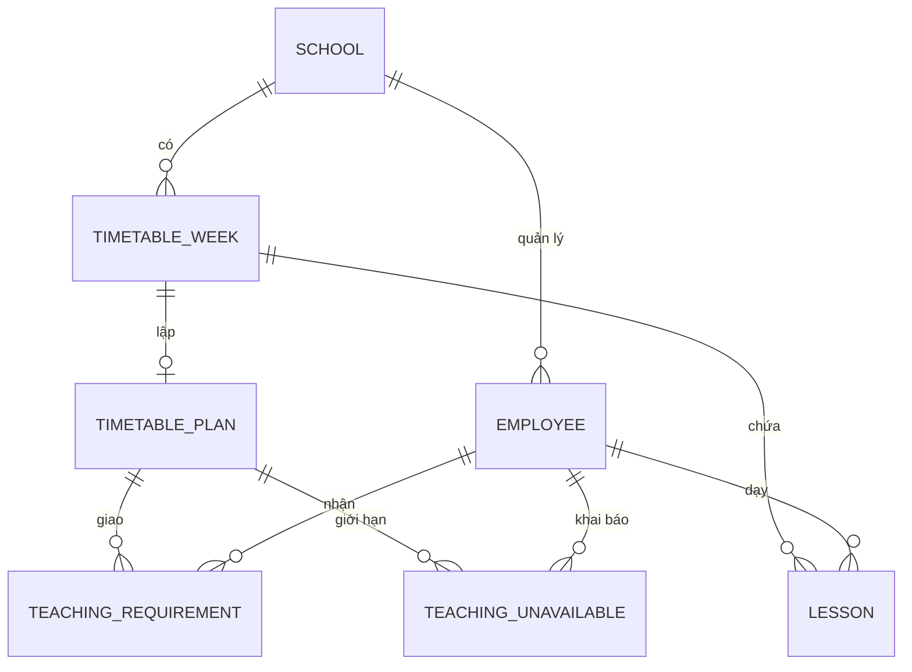

# Thời khóa biểu lên lớp

## Sử dụng

1. Mở **Thời khóa biểu lên lớp** trong menu **Giảng dạy**, chọn hoặc tạo tuần bằng ngày thứ Hai.
2. Mở **Phân công và tự động xếp lịch**. Chọn ngày học và số tiết sáng, chiều. Tiết đầu buổi chiều nối số sau tiết cuối buổi sáng. Ví dụ với năm tiết sáng, tiết đầu buổi chiều là tiết 6.
3. Nhập phân công thủ công hoặc tải mẫu Excel trên màn hình. Mỗi dòng chứa mã giáo viên, lớp, môn, phòng, tổng số tiết tuần, số cặp tiết đôi và buổi được phép. Dùng mã đã có trong Nhân sự. Điền số tiết của các cặp đôi trong tổng số tiết. Ví dụ tổng 4 tiết và 1 cặp nghĩa là một cặp và hai tiết lẻ. Cột Buổi nhận Sáng, Chiều, Cả hai hoặc để trống.
4. Với Excel, đọc báo lỗi hoặc xem trước các dòng, rồi xác nhận. Có thể nhập nhiều tệp nếu các dòng phân công không trùng.
5. Khai báo giờ giáo viên bận. Ngày lễ và ngày nghỉ đã duyệt cũng được kiểm tra. Các tiết đã có trên lưới được giữ cố định trong lần chạy.
6. Bấm **Tạo phương án CP-SAT**. Đọc chẩn đoán hoặc xem các tiết đề xuất. **Xác nhận đưa vào bản nháp** mới ghi dữ liệu. Khi kế hoạch, giờ bận hoặc lịch có thay đổi trong lúc xem, tạo lại phương án.
7. Trình duyệt trên lưới tuần. Khi đã lập kế hoạch, lịch phải đủ tiết và đáp ứng các ràng buộc mới được duyệt và công bố. Người có quyền phê duyệt công bố và giáo viên nhận thông báo.
8. Lọc theo lớp, giáo viên hoặc phòng rồi xuất PDF A4, Excel hoặc Word.

Các tuần có từ phiên bản cũ tiếp tục làm việc theo cách nhập tay. Để dùng CP-SAT trên tuần cũ ở trạng thái nháp, khai báo phân công tương ứng với các tiết cần giữ và xử lý chẩn đoán nếu dữ liệu cũ khác kế hoạch.

## Dữ liệu và xử lý

- Chỉ tạo biến cho vị trí còn trống, đúng buổi, đúng phòng đã khai báo và giáo viên khả dụng. Dùng biến cặp để bảo đảm tiết đôi liền nhau trong cùng buổi. Ràng buộc trùng giáo viên, lớp và phòng dùng chung cho tất cả phân công trong tuần.
- Phương án giữ các tiết đang có, xếp đủ tiết và giảm số tiết cùng môn của một lớp vượt hai tiết mỗi ngày. Bộ kiểm định độc lập chạy sau khi giải, trước khi ghi và tại các bước duyệt.
- Hệ thống trả trạng thái CP-SAT và thời gian xử lý. `OPTIMAL` áp dụng cho hàm mục tiêu của bản này. `FEASIBLE` là phương án hợp lệ. `UNKNOWN` cho biết hết thời gian tìm và chưa kết luận được khả thi.
- Xem chẩn đoán JSON tại `GET /thoi-khoa-bieu/<id>/kiem-tra.json` với phiên đăng nhập và quyền lập lịch. Phản hồi có mã tuần, số tiết yêu cầu, số tiết hiện có và các lỗi kiểm định.
- Biểu mẫu có số phiên bản. Bản xem trước ký theo tài khoản và tuần, hết hạn sau 20 phút. Khi xác nhận phương án, hệ thống kiểm tra lại bản ghi và các ràng buộc hiện hành. PostgreSQL chặn gán giáo viên khác trường tại cơ sở dữ liệu.

## Kiểm thử và phát hành

Cài `requirements.txt`, chạy `python manage.py migrate` trên cơ sở dữ liệu kiểm thử, rồi chạy `python manage.py test`. Các ca mới dùng dữ liệu kiểm thử. Trước khi phát hành lên hệ thống đang chạy, xác minh bản sao lưu PostgreSQL và phương án phục hồi. Migration 0007 bổ sung cấu trúc kế hoạch và giữ các tuần, tiết cũ. Bộ giải chạy một luồng với ngân sách 6 giây và giới hạn 500 tiết khai báo mỗi tuần.

Bản này dùng mỗi tiết cho một lớp, một giáo viên và một phòng cố định. Lớp ghép, đồng giảng, nhóm tự chọn, giờ theo phút giữa các điểm trường, quản lý nhiều phương án, AI ngôn ngữ tự nhiên và SaaS nằm ở các giai đoạn sau.
